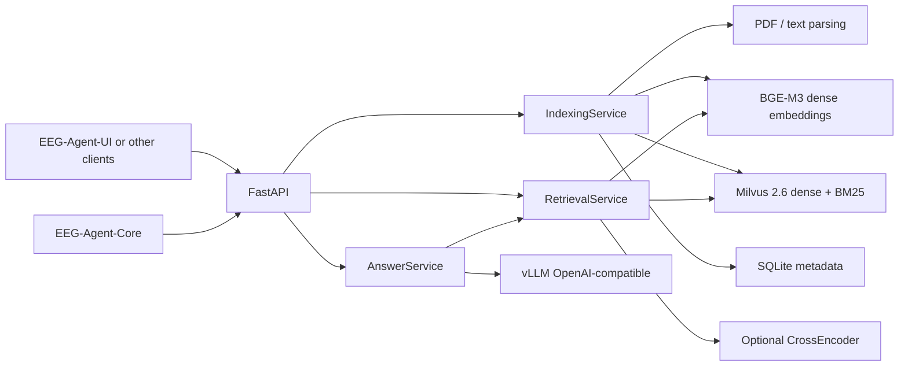

# Design and reliability boundaries

## Component diagram

## Index format and upgrades

Milvus data collection `eeg_rag_v1` owns `id` (content digest and chunk ordinal),
`document_id`, `content` (analyzed VARCHAR), `dense` (1024-d float vector),
`sparse` (server-side BM25), source metadata, DOI, page, and year. The schema is
not migrated automatically: change collection name to `eeg_rag_v2` when adjusting
embedding dimensions, analyzer or metric; rebuild from source documents.

## Semantics

- Import is **synchronous per request**, using `asyncio.to_thread` to avoid blocking the event loop.
  A background queue/worker is not implemented.
- Hashing the file bytes gives a stable document ID and deduplication within one local collection.
- Failed index batches mark a document `failed`; retry reindexes and replaces its previous chunks.
  If a process dies between batches, restart and explicitly retry ingestion.
- Milvus and SQLite are separate stores, and writes are **not distributed transactions**.
  Use operator repair/reindex on exceptional crash windows.
- Citation checks verify IDs `[S1]` correspond to retrieved excerpts but do not
  automatically verify the factual truth/entailment of every statement.
- File loaders don't follow URLs or run executable document contents. PDFs are parsed locally;
  image-only PDFs are rejected. Metadata is for discovery, not permission enforcement.

## Security and performance limitations

- Single tenant; no account-scoped document ACL. **Do not** put private patient data in
  a shared collection. Redact and isolate sensitive data before deployment.
- Optional `RAG_API_KEY` allows single-secret API protection. Real deployments should use
  TLS, users/roles, tenant filters, rate limits, CORS restrictions and audit logs.
- Malicious document instructions are untrusted. Prompt-based isolation is best-effort,
  not a substitute for stronger policy enforcement and no untrusted tools.
- BGE embedding and CrossEncoder load lazily. For multiple server workers, each worker
  would replicate models into memory: use one API worker or dedicated model servers.
- Standard analyzer is primarily suited to English text. Evaluate language-aware analyzers
  on Chinese corpora before deploying bilingual lexical search.
- No OCR, Docling complex-layout extraction, async worker queue, or GraphRAG in this release.
